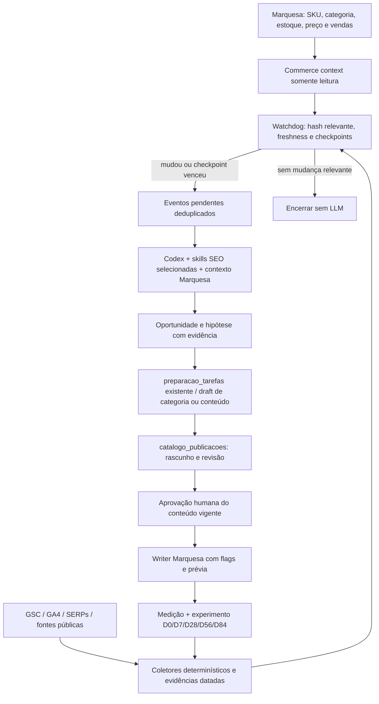

# Marquesa Intelligence — proposta Codex-first

Status: **proposta para revisão**, 03/10/2026. Nenhum módulo, tabela, cron ou
integração descrito como futuro foi implantado por este documento.

## Objetivo e limites

Transformar dados em oportunidades, hipóteses, drafts revisáveis, ações
aprovadas e aprendizado comercial mensurável. Codex é o executor principal;
Claude SEO é toolkit subordinado ao contexto e contratos da Marquesa.
Esta rodada entrega auditoria, skills locais e plano. Implementação e
ativação externa serão trabalhos separados.

SEO + estoque + preço + disponibilidade + vendas governam a interpretação.
Impressões, cliques e posições são sinais intermediários. Sem estoque,
janela de preço e pagamento, não concluir que SEO causou perda de receita.

## Alternativas e escolha recomendada

| Desenho | Vantagem | Problema |
|---|---|---|
| Agente SEO separado com catálogo próprio | Início rápido | Duplica produto, estados e aprovação; diverge do ERP |
| Codex + contratos de preparação existentes + fatos externos relacionados | Reusa identidade, rascunho, revisão e writer | Exige conectores e ledger de evidências bem definidos |
| Plataforma completa de growth antes de primeiro caso | Grande cobertura | Custo e migrations antes de provar valor |

Recomendação: segunda alternativa, por fatias. Primeiro uma PDP e um conjunto
de queries com dados verificáveis; depois ampliar. Não instalar todos os
provedores nem ativar toda a superfície Claude SEO.

## Arquitetura

Áreas lógicas, sem obrigação de serviço/banco separado:

- **SEO Engine:** adapters GSC/GA4/SERP, auditoria técnica, mapa de intenção e
  oportunidades; Claude SEO entra como funções de análise e preparação.
- **Commerce Intelligence:** lê produto, variantes, custo/preço, saldo em casa,
  consignação, pedidos, vendas e pagamentos na fonte operacional.
- **Content Intelligence:** editoria, evidências públicas, patterns, hooks,
  roteiro e resultados. Produto permanece na Marquesa.
- **Experiment Engine:** baseline D0, checkpoints e histórico de intervenções.
- **Action Layer:** draft, revisão, aprovação vigente, execução idempotente,
  erro, medição e rollback. Reusa a fila e o writer existentes para produto.

## Identidade e dados

O schema atual usa `produtos.sku` como chave local. `categorias.id`,
`produto_variacoes.variante_id` e `produtos.produto_id_loja` têm papéis
distintos. `produto_id_loja` identifica o canal Nuvemshop; não é uma nova
entidade comercial. Usar FKs/relacionamentos aos IDs reais, não nomes.

As entidades futuras abaixo são contratos conceituais, **não migrations**:

| Fato/entidade | Grão e vínculo proposto | Evitar |
|---|---|---|
| Coleta | fonte, propriedade, intervalo, dimensão, versão, hash, status, timestamp | Contagem sem período ou origem |
| GSC | dia × query, dia × page e dia × query × page, consultados separadamente | Somar agregações incompatíveis |
| GA4 | período × landing/canal; eventos e item conforme relatório compatível | Misturar métricas de sessão e item sem conferir escopo |
| Página | URL normalizada + canonical + validade + SKU/categoria opcional | Unir PDP por nome ou ignorar redirects |
| Keyword opportunity | keyword, cluster, intenção, SKU/categoria/URL, posição/impressões/CTR, evidências concorrentes, prioridade comercial, status | Inventar volume, posição ou rank fora do recorte observado |
| Hipótese/ação | evidências, métrica-alvo, responsável, draft, aprovação e versão | Aplicar texto gerado como decisão de negócio |
| Experimento | página, intervenção, baseline, checkpoints, confounders e desfecho | Tratar simples antes/depois como causalidade |
| Conteúdo | content_id, SKU/categoria opcional, hook/roteiro/formato/modelo, custo, publicação e medição | Copiar cadastro ou receita operacional |
| Observação comercial | snapshot referenciado de preço/saldo/disponibilidade/ruptura | Confundir snapshot histórico com catálogo atual |

Um conteúdo pode envolver várias peças ou nenhuma peça específica; um item
de venda pode resultar de vários contatos. Planejar associações múltiplas e
grau de confiança. Receita GA4 é telemetria; a verdade financeira continua
nos contratos operacionais da Marquesa. Custos e ROI só quando há base
validada, devoluções/descontos conhecidos e regra explícita de cálculo.

Antes de schema futuro: consultar schema implantado, revisar incrementalidade,
FKs, cardinalidade, retenção e idempotência com `safe-d1-change` e guardião do
banco. Não criar uma tabela de produtos SEO.

## GSC e GA4: primeiro contrato de coleta

GSC: duas janelas principais, 28 e 90 dias, com períodos anteriores iguais
para comparação. Usar dias finais disponíveis e registrar a data efetiva,
timezone da fonte, `dataState`, filtros, search type e agregação. Extrair
query, page e query+page separadamente, com paginação e relatório de cobertura.
Ausência pode ser anonimização/limite de linhas, não zero nem rank ausente.
CTR agregado deve ser cliques/impressões; posição usa a definição da fonte,
sem média ingênua entre recortes. [Contrato Google](https://developers.google.com/webmaster-tools/v1/searchanalytics/query).

GA4: confirmar propriedade, timezone, consentimento, canal da sessão,
landing page, instrumentação dos eventos `view_item`, `add_to_cart`,
`begin_checkout` e `purchase`, item_id, transaction_id e currency. Usar
relatórios compatíveis com o escopo das dimensões/métricas. Organic Search
não é o mesmo que todas as vendas de origem `site`.
[Dimensões/métricas da Data API](https://developers.google.com/analytics/devguides/reporting/data/v1/api-schema).

`QUERY → LANDING → PRODUTO → PEDIDO` é associação analítica agregada quando
GSC não fornece identidade de sessão. Não prometer atribuição individual da
query. Transaction ID pode apoiar reconciliação GA4–Nuvemshop quando tiver
contrato confirmado; divergências ficam explícitas. Sem identidade confiável,
reportar métricas em paralelo, não completar a cadeia com suposição.

## Reuso da fila de produto

| Pedido conceitual | Equivalente atual / adaptação proposta |
|---|---|
| Cadastrado | `produtos`, completude única |
| Aguardando conteúdo | `pronto_para_preparacao` |
| Conteúdo em geração | `em_preparacao` + tarefa aberta |
| Conteúdo gerado / SEO preparado | Rascunho nome/descrição/SEO + avaliação anexada; não criar estado novo inicialmente |
| Aguardando revisão | `aguardando_aprovacao` |
| Aprovado / pronto para publicar | `aprovado_para_publicar` com assinatura vigente e preflight externo |
| Publicando / publicado | Estados reais do writer; distinguir presença observada e publicação visível |
| Erro / retirado | `falhou_ao_publicar` / `despublicado` |

Codex deve receber tarefa, SKU e contexto versionado; produzir o mesmo
contrato que `concluirTarefa` já aceita. Salvar rascunho muda dados reais,
mesmo sem publicação; por isso não foi executado nesta rodada.
Nome comercial sugerido não pode renomear `produtos.desc` silenciosamente.
Categoria, atributos e imagens propostos devem usar IDs existentes e revisão
explícita. Alt/schema/links podem nascer como sugestões anexas até que haja
contrato de armazenamento e capacidade Nuvemshop demonstrados.

## Experimentos e conteúdo

Baseline D0 inclui versão da página e intervenção exata, query/page,
cliques/impressões/CTR/posição, preço, saldo em casa, ruptura, pedidos,
receita e período. D7 é leitura antecipada; D28/D56/D84 acumulam evidência.
Não reescrever por agenda: checkpoint pode terminar com nenhuma ação.
Comparar sazonalidade, promoções, disponibilidade, alterações de tema e mix
de queries. Baixo volume exige resultado inconclusivo, não falsa precisão.

Content Brain: conteúdo/publicação separados das observações 1h/24h/7d.
Métricas views, likes, comments, saves, shares, profile visits, DMs, clicks,
carrinho, checkout, orders e revenue são nullable e têm fonte/grão/período.
Contagens públicas não revelam saves, shares, DMs ou ROI privados. Comparar
hooks/formatos com tamanho de amostra, custo e qualidade da atribuição.
Os cinco pilares históricos são hipóteses editoriais a validar.

## Watchdog e custo

Coletores e cálculos: código determinístico. IA: interpretação de intenção,
hipótese, originalidade/briefing, revisão de texto e síntese de patterns.
Agendamento futuro sugerido, sujeito a quotas e freshness real:

- Coletores incrementais diários quando existirem dados novos.
- Mudança de produto/ficha: evento com debounce e hash de campos relevantes.
- SERPs/concorrentes: amostra priorizada, semanal ou por hipótese; budget fixo.
- Experimentos: somente checkpoints vencidos; métricas novas são evento legítimo
  mesmo que HTML da página permaneça igual.
- Sem mudança/freshness/checkpoint: encerrar sem Codex/LLM.

Deduplicação deve usar entidade + tipo de evento + hash + período. Enfileirar
apenas uma análise para a mesma mudança. Ter lease, retry limitado, backoff,
expiração e fila de falhas. Nunca rearmar o cron de sync de estoque para SEO.

## Observabilidade e rollback

Cada run registra: trigger, entidades/intervalos, evidências/hashes,
executor/skill/revisão/modelo, hipótese, ação/diff, aprovação/versão, execução
externa/ID, resultado/checkpoints, custo, erro/retry e rollback preparado.
Não registrar credenciais/PII. A chave compartilhada atual limita autoria:
o rótulo `aprovadoPor` não é identidade autenticada individual.

Rollback futuro: armazenar payload antes/depois e revisão aprovada; não apagar
produto com estoque/pedido/histórico. Despublicar é ato externo com aprovação.
Timeout após criação requer reconciliar ID antes de retry para evitar anúncio
duplicado. Mudança de estoque passa exclusivamente pela razão existente.

## Backlog priorizado

Esforço relativo: P = 1–2 dias; M = 3–5; G = 1–2 semanas; GG = mais de duas
semanas. Estimativas dependem de acessos e descoberta; não são compromissos.
Risco refere-se à implementação futura. Aprovação humana abaixo distingue
escolha/configuração/conteúdo de execução técnica sob a governança vigente.

| Prioridade / item | Problema → solução | Impacto | Esforço | Risco | Dependências | IA | Aprovação humana |
|---|---|---|---|---|---|---|---|
| P0.1 Evidências do legado | Só resumos → recuperar exports/backups externos e validar schema/período/hash | Evita perder aprendizado e importar lixo | M | Médio | Acesso legado somente leitura | Não | Acesso e seleção das fontes |
| P0.2 Identidade página–SKU | URL/ID externo sem contrato SEO → mapear SKU/variante/categoria/canonical com validade | Uma verdade operacional | M | Médio | Schema/runtime real e catálogo | Só ambiguidades | Resolver matching ambíguo |
| P0.3 Runtime toolkit | Launcher Claude não existe no Codex → runner local isolado, limitado a leitura, testado | Skills executáveis com custo previsível | M | Baixo | Manifesto, Python/browser e revisão scripts | Não | Configuração externa quando necessária |
| P0.4 Ledger de coleta/runs | Sem lineage → contrato de evidência/retention/custo/idempotência | Auditoria e reprocessamento | M | Médio | P0.2, revisão D1 antes de migration | Não | Contrato de retenção/autoria |
| P0.5 Baseline real | Memória temporal stale → ler deployments/schema/flags e registrar evidência por ambiente | Evita instalar sobre suposição | P | Baixo | Credenciais read-only Cloudflare/GitHub | Não | Acesso, caso ausente |
| P1.1 GSC 28/90 | Sem connector → collector query/page/query+page + comparação e coverage | Oportunidades por intenção | M | Médio | Acesso GSC, P0.4 | Não na coleta | Propriedade e permissões |
| P1.2 GA4/funil | Receita sem canal orgânico → verificar eventos e coletar landing/event/item | Prioriza conversão | G | Médio | Propriedade GA4, consentimento, IDs | Não na coleta | Configuração/instrumentação |
| P1.3 Keywords | Sem mapa validado → clusters e prioridade comercial com evidências SERP/GSC | Descobre demanda genérica | M | Baixo | P1.1, SERP, estoque/preço | Sim na intenção | Prioridades/editoria |
| P1.4 SEO técnico Nuvemshop | Sem baseline storefront → PDP/categoria/robots/sitemap/canonical/schema/CWV por amostra | Remove barreiras reais | M | Baixo na leitura | URL real e ferramentas disponíveis | Parcial | Mudanças externas, se propostas |
| P1.5 Experimentos | Sem checkpoints persistidos → D0/D7/D28/D56/D84 + confounders | Aprendizado mensurável | G | Médio | P0.4, P1.1/2, commerce snapshots | Só síntese | Intervenção inicial e nova ação |
| P2.1 Codex preparador | Executor ainda assistido → adaptar ao contrato de tarefas existente | Conteúdo sem fila duplicada | M | Médio | P0.2/3, tarefas, contexto de marca | Sim | Revisão de conteúdo; nunca autoaprovar |
| P2.2 Qualidade da ficha | Faltam atributos/keywords/alt/links → sugestões verificáveis no draft | PDP coerente e revisável | M | Médio | P1.3, catálogo/galeria | Sim | Fatos ambíguos e texto final |
| P2.3 Writer completo | Payload não envia galeria/categoria/variantes → mapear capacidades reais e ensaio fiel | Prepara publicação segura | G | Alto | API Nuvemshop, IDs, R2, testes mock | Não | Contrato comercial e ativação futura |
| P2.4 Retry/rollback | Criação externa pode ficar incerta → reconciliação de IDs, idempotência e versão anterior | Evita anúncios duplicados | M | Alto | P2.3, logs e snapshots | Não | Ação externa sob aprovação vigente |
| P3.1 Conteúdo/observações | Content Brain só conceitual → entidades relacionadas, métricas nullable, custos | Aprendizado por hook/formato | G | Médio | P0.4, URLs/IDs plataformas | Parcial | Modelo editorial/retention |
| P3.2 Métricas privadas | Saves/DM/ROI não públicos → acesso próprio autorizado ou export validado | Mede intenção e vendas | G | Médio | Permissões Meta/analytics, tracking | Não | Acessos/consentimento |
| P3.3 Editoria | Pilares históricos sem validação → calendário por intenção e hipótese | Identificação e conversão | M | Baixo | Marca, P3.1/2, disponibilidade | Sim | Copy/roteiro/publicação |
| P4.1 Concorrentes | Sem corpus verificável → coletas públicas com data, fonte e contexto | Patterns de oferta/hook/formato | M | Médio | Lista priorizada, termos e quotas | Na classificação | Lista/limite de custo |
| P4.2 Trends e criativos | Sinais dispersos → hipóteses originais, benchmark normalizado | Novas oportunidades | M | Médio | P4.1, Trends/Ad Library/Creative Center | Sim | Hipótese e criativo final |
| P5.1 Watchdog barato | Legado indisponível/cron caro → hash/freshness/eventos sem LLM em no-op | Eficiência | M | Médio | P0.4, coletores, P1.5 | Só downstream | Agenda e teto de consumo |
| P5.2 Scheduler e limites | Sem worker de intelligence → leases/retries/budget/dedup separado do sync | Operação previsível | G | Médio | P5.1, observabilidade | Não | Ativação técnica na rodada autorizada |
| P5.3 Action ledger | Aprovação sem histórico growth completo → versões/diffs/resultados/rollback | Auditabilidade fim a fim | M | Alto se writer | P2.4, P0.4 | Não | Ações/conteúdo vigentes |
| P6.1 Experimentos causais | Baixo volume/antes-depois → desenho estatístico proporcional e incerteza | Decisões melhores | G | Médio | Volume suficiente, P1.5/P3 | Parcial | Métrica e desenho |
| P6.2 ROI e recomendação | Atribuição/custo incompletos → receita líquida validada e custo total | Eficiência comercial | G | Alto | Dados financeiros, P1.2/P3.2 | Na recomendação | Regra financeira/atribuição |
| P6.3 GEO/backlinks/multicanal | Básico ainda ausente → avaliar por evidência e ganho incremental | Expansão | G | Médio | P1 concluído, orçamento provedores | Parcial | Contratação e prioridades |

## Próxima fatia recomendada

P0.1/P0.2/P0.3 com baseline somente leitura e contrato GSC: recuperar ou
declarar indisponíveis os exports do legado, confirmar propriedades e IDs,
adaptar um runner de leitura e gerar relatório 28/90 com uma PDP e sua
categoria. Sem publicação. Critério de sucesso: lineage verificável, nenhuma
duplicação de produto, zero LLM no no-op, oportunidades relacionadas ao saldo
e preço, uma hipótese mensurável e um draft demonstrativo revisável.
